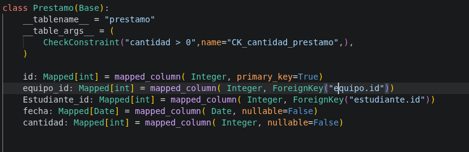
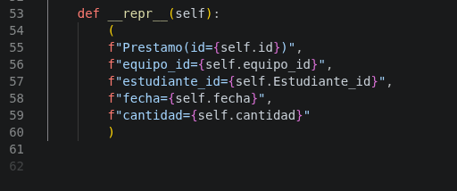
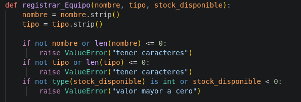
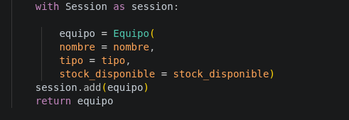
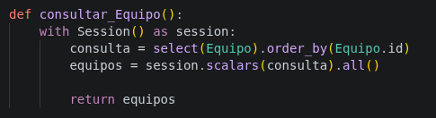
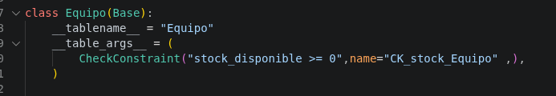

# laboratorio_Torres_Miguel
## FILA A

entrega del laboratorio elaborado en clases de tablas en foreignkey, etc, de la fila A

---------------------------------
---------------------------------
# Hoja de respuestas y evidencias

Nombre: miguel Ignacio Torres Tureo
Fecha: 10/11/26

### pregunta 1
- Muestre la definición de Prestamo, sus claves foráneas y relaciones con Equipo y Estudiante. Explique
qué relaciona cada clave.

Respuesta:

- Archivo: modelo.py, linea 40
- funcion:

- respuesta: 

- explicacion: prestamo es una de las entidades de la tabla del ejercicio de la fila A, es el que genera conexion con las clases con foreingkey, estas crea relacion con los IDs de las clases, como id_equipo, id_estudiantes, es el cuausante de generar listas de contenido tesporaneo, tiene las mismas propiedades de un equipo o estudiante, con una fecha limite y la cantidad total de prestamos en la universidad

### pregunta 2
- Muestre la función que registra un equipo. Señale dónde utiliza session.add() y cómo confirma la
persistencia.

- archivo: insertar.py, linea 5

- funcion:

- respuesta:

- esplicacion: genera el ssession ad en la linea del codigo 22, este en primero que pasa es por una series de parametros para que la informacion que se recopile no sea erroneo y con caracteres vacios, esto se forma por if y raise valuerror, de respuesta, esto al pasar el fintro que este todo vien Session que este es de la tabla, este toma la Session lo guarda de forma nueva por session, y por el mismo add(equipo) se guarda el resultado en la base de datos generando persistencia

### pregunta 3

- Copie una consulta ORM con select() que obtenga equipos con stock_disponible mayor que cero.
Explique el filtro.

- archivo: consulta.py linea 5, modelo.py linea 10 

- funcion:

- respuesta:

- explicacion:el fintro selecciona de forma de la base de datos y los orde de forma por su id, toma todos los valorees y y en main deberia imprimirlo los datos, en los stock, este se genera error cuando hay un cero por modelos con el check, o por el mismo insercion de datos
