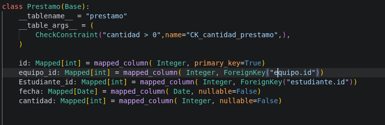
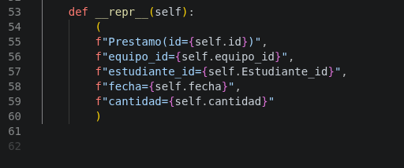

# Hoja de respuestas y evidencias

Nombre: miguel Ignacio Torres Tureo
Fecha: 10/11/26

### pregunta 1
- Muestre la definición de Prestamo, sus claves foráneas y relaciones con Equipo y Estudiante. Explique
qué relaciona cada clave.

Respuesta:

- Archivo: modelo.py, linea 40
- funcion:

- respuesta: 

- explicacion: prestamo es una de las entidades de la tabla 